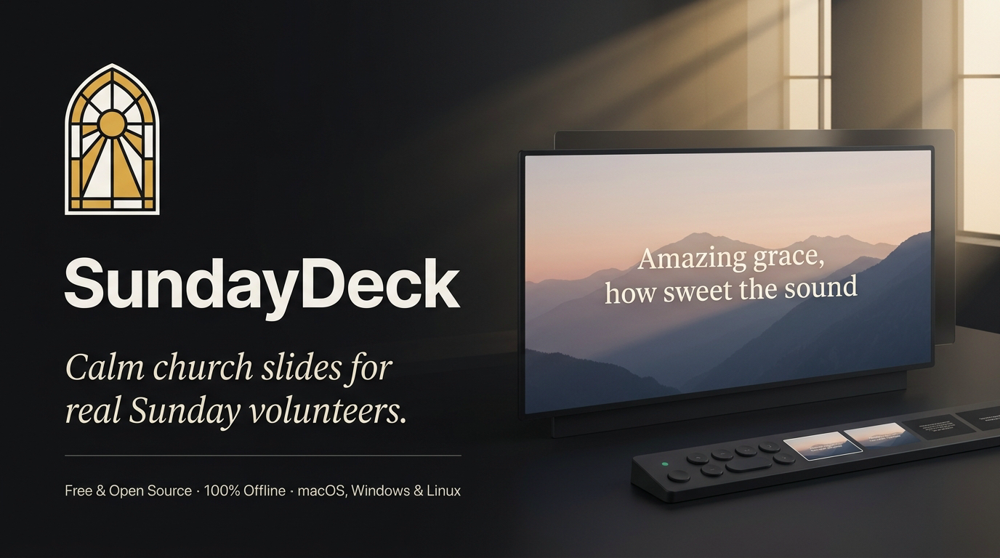
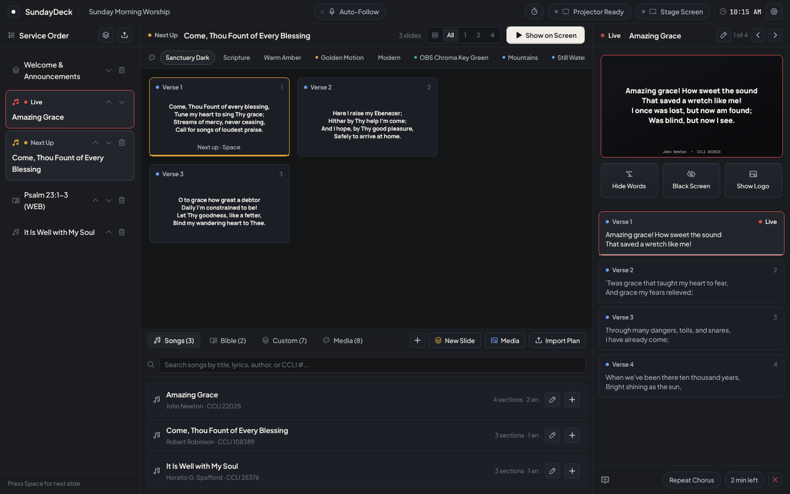
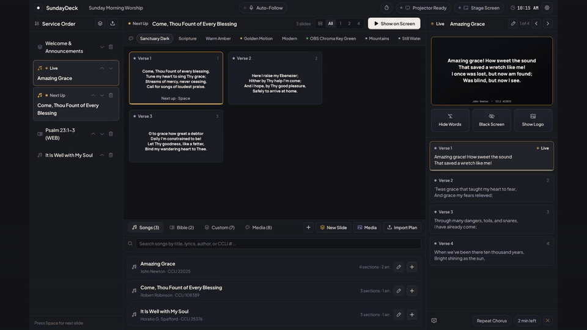
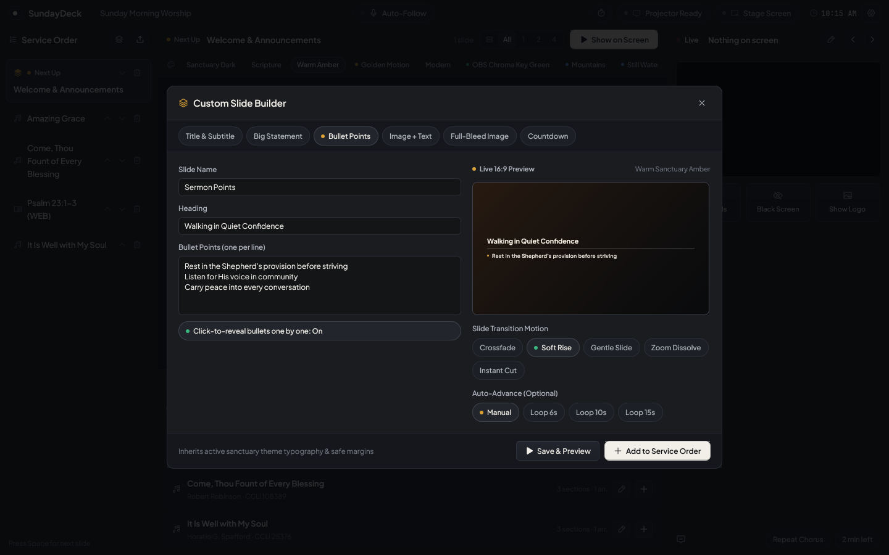

<div align="center">



<br />
<br />

[](.github/workflows/release.yml)
[](LICENSE-MIT)
[](#why-sundaydeck)
[](https://tobhoster.github.io/sundaydeck/)

**Calm, free, offline church presentation software built for real Sunday volunteers.**

*Zero subscriptions. Zero internet required. Instant startup on Mac, Windows, and Linux — with songs, Protestant & Catholic Bibles, numbered hymnbooks, built-in slide layouts, stage monitor, livestream lower-thirds, and hands-free microphone auto-follow.*

<br />



</div>

---

## Product Film & Walkthrough

Watch the 45-second narrated overview (`docs/media/sundaydeck-promo-ad.mp4`) or preview the live workflow below:

<div align="center">
  
  <br />
  <sub>
    <strong>Narrated launch video:</strong> <a href="docs/media/sundaydeck-promo-ad.mp4"><code>docs/media/sundaydeck-promo-ad.mp4</code></a> ·
    <strong>Silent HD walkthrough:</strong> <a href="docs/media/sundaydeck-walkthrough.mp4"><code>docs/media/sundaydeck-walkthrough.mp4</code></a> ·
    <strong>Website:</strong> <a href="docs/index.html"><code>docs/index.html</code></a>
  </sub>
</div>

---

## Why SundayDeck?

Most church presentation apps are either expensive subscriptions, sluggish on older church laptops, or cluttered with broadcast jargon that intimidates a volunteer stepping into the booth ten minutes before service.

SundayDeck is designed around quiet, predictable Sunday morning craft:

- **Calm, volunteer-first workspace** — Warm dark surfaces, plain-English controls (`Show on Screen`, `Hide Words`, `Black Screen`, `Show Logo`), strict Preview vs. Live separation, click-outside & `Esc` modal dismissal, right-click editing on hymns/verses/slides, and live **Quick Edit** to fix a typo without disturbing the sanctuary screen.
- **Ready on Day 1 — Zero Empty State** — Ships with **19 verified Public Domain hymns** (English, Spanish, Portuguese & Catholic), **BSB, WEB & KJV** ready immediately offline, **1-click full 31k-verse Bible downloads** (English BSB/KJV/ASV/CPDV/DRC, Spanish RV1909, Portuguese Bíblia Livre, French Synodale & Crampon), **12 studio themes**, 6 sanctuary photos, 2 motion timelapse loops, and **7 bundled projection fonts**.
- **Built-in Slide Layouts, Quick Slides & Nursery Alerts** — 1-click **Pastor Quote** and **Member Birthday** quick slides, click-to-reveal sermon points, image + text announcements, pre-service countdowns, call-and-response liturgy, and discreet **Nursery / Parent Paging Alert** overlays (`Parent #142`) that never interrupt worship lyrics.
- **Pastor Notes to Service Order** — Drop a pastor's PowerPoint (`.pptx`), Word document (`.docx`), or plain sermon outline to build a reviewable service order in seconds — matching songs, pulling Scriptures offline, and laying out sermon points.
- **Sanctuary, Stage & Livestream Ready** — Independent Audience Projector and **Stage Confidence Monitor** windows (with current + next slide, clock, amber warning / red overtime sermon timers, and private stage cues like *"Wrap up — Communion next"*), plus a built-in local **OBS Studio** transparent lower-third overlay and chroma-key theme.
- **Hands-Free Microphone Auto-Follow** — Listens locally to your room mic or soundboard to follow sung lyrics in safe Suggest/Auto modes and queues spoken sermon Bible verses for one click — completely offline.
- **Built for Churches Across the Americas + Portable `.sdeck` Bundles** — Full **66-book Protestant & 73-book Catholic Bibles**, accent-tolerant search (English, Spanish, Portuguese, French), **parallel dual-translation Scripture**, **numbered hymnbooks** (`BH 330`, `UMH 378`, `CC 1`, `HGT 42`), **bilingual stacked lyrics**, and self-contained **`.sdeck` / `.sdeck-pack`** archives so volunteers can prep on a home laptop Saturday night and open everything cleanly in the booth Sunday morning.
- **Easy Library Migration** — Import existing libraries from EasyWorship, OpenLP, ProPresenter, VideoPsalm, FreeShow, ChordPro, OpenLyrics, SongSelect (`.usr`/`.txt`), and standard USFM/USFX/OSIS/Zefania/SQLite/Scrollmapper Bibles.

---

## Download & Install

Visit the **[Download Page](https://tobhoster.github.io/sundaydeck/download.html)** or install in one line:

### macOS & Linux (One-Line Installer)

```bash
curl -fsSL https://tobhoster.github.io/sundaydeck/install.sh | sh
```

### Windows (PowerShell One-Line Installer)

```powershell
irm https://tobhoster.github.io/sundaydeck/install.ps1 | iex
```

Or download installers directly from **[GitHub Releases](https://github.com/tobhoster/sundaydeck/releases/latest)**:
- **macOS:** `SundayDeck-<version>-macOS-arm64.dmg` (Apple Silicon M1–M4) or `SundayDeck-<version>-macOS-x86_64.dmg` (Intel)
- **Windows:** `SundayDeck-<version>-windows-x86_64-setup.exe` (installer) or `SundayDeck-<version>-windows-x86_64.zip` (portable)
- **Linux:** `sundaydeck_<version>_amd64.deb` (Debian/Ubuntu) or `SundayDeck-<version>-linux-x86_64.tar.gz` (portable)

---

## 5-Minute Volunteer Guide

### 1. Plan Your Service — or Drop the Pastor's PowerPoint / Word File

Click the **Upload** button in the **Service Order** rail to drop a `.pptx`, `.docx`, or plain outline. SundayDeck matches your songs, fetches Scriptures offline, formats sermon points, and lets you review every slide before adding it to your Sunday schedule.

| Plan Importer | Built-In Slide Layouts |
| :---: | :---: |
|  |  |

### 2. Choose Peaceful Public Domain Backgrounds & Connect Your Displays

Pick bundled **Public Domain** sanctuary photography and National Park Service motion timelapse loops, paste any online photo (including Unsplash) or `.mp4` / `.webm` video URL, load local worship loops with custom contrast scrims, send clean output to your projector and **Stage Confidence Monitor**, or toggle the built-in **OBS Livestream Overlay** (`http://127.0.0.1:8787/overlay`) directly from the **Projector** menu.

| Sanctuary Photography (Public Domain) | Stage Confidence Monitor |
| :---: | :---: |
|  |  |

### 3. Protestant, Catholic & Bilingual Churches Across the Americas

Open **Settings → Bibles & Packs** to choose your **Church Tradition** (`Contemporary`, `Baptist & Evangelical`, `Methodist / Mainline`, `Catholic Parish`, `Spanish / Portuguese`), toggle **Bilingual Stacked / Primary / Secondary** lyrics, import 66- or 73-book offline Bibles, or install verified Public Domain `.sdeck-pack` starter packs.

> **Copyright Respect:** SundayDeck never bundles copyrighted contemporary worship songs or copyrighted Bible translations. Verified Public Domain starter packs can be generated reproducibly with `python3 scripts/build-starter-packs.py`, and churches can import their own legally licensed hymnbooks and Bibles in seconds.

| Bilingual Call & Response | Church Tradition & Offline Packs |
| :---: | :---: |
|  |  |

### 4. Hands-Free Microphone Auto-Follow

Click **Auto-Follow** in the top bar, choose your microphone or soundboard input, and select **Suggest next slide** (highlights the next slide with a warm amber ring) or **Advance automatically**. During the sermon, spoken Bible references appear cleanly in a **1-Click Scripture Queue** on the right without ever hijacking the live screen.

<div align="center">
  
</div>

---

## Keyboard Shortcuts

| Action | Shortcut |
| :--- | :--- |
| Next live slide (or reveal next bullet point) | `Space` / `Right` / `Down` |
| Previous live slide | `Left` / `Up` |
| Show staged preview on screen | `Cmd/Ctrl + Enter` |
| Hide Words (keep background) | `F1` (`Shift + F1` instant cut) |
| Black Screen | `F2` (`Shift + F2` instant cut) |
| Show Church Logo | `F3` (`Shift + F3` instant cut) |
| Fix a typo live (Quick Edit) | `Cmd/Ctrl + E` |
| Toggle Audience Projector window | `Cmd/Ctrl + Shift + A` |
| Toggle Stage Confidence Monitor | `Cmd/Ctrl + Shift + S` |

---

## Church Software Should Be Free — Open to Contributions

We believe church presentation software should be **free, simple, and accessible to every congregation** — from a church plant meeting in a school cafeteria to a full sanctuary with a volunteer media team.

- **Completely free — no seat licenses, no activation keys, no annual renewals, no paywalls, and no watermarks.** Install SundayDeck on as many church computers and volunteer laptops as you need.
- **Open to contributions:** Read [CONTRIBUTING.md](CONTRIBUTING.md) and our [Code of Conduct](CODE_OF_CONDUCT.md) — pull requests, volunteer feedback, Spanish / Portuguese / French translations, and verified public-domain starter packs are all warmly welcome.
- **Helpful Resources for Your Booth:** [1-Page Printable Sunday Volunteer Cheat Sheet](docs/cheat-sheet.html) · [Public Domain Starter Packs & Migration Guide](docs/packs.html).

### Support the Movement (Optional)

SundayDeck will always remain 100% free with zero locked features. If it blesses your church on Sunday mornings and you'd like to help cover Apple & Windows code-signing certificates, hosting, and ongoing maintenance:

- **[Buy Me a Coffee](https://buymeacoffee.com/tobhoster)** — one-time coffee or encouragement
- **[GitHub Sponsors](https://github.com/sponsors/tobhoster)** — monthly or one-time church & community sponsorship
- **Or simply share SundayDeck** with a neighboring church or volunteer team!

---

<details>
<summary><strong>For Developers: Building from Source</strong></summary>

```bash
git clone https://github.com/tobhoster/sundaydeck.git
cd sundaydeck
cargo run --release -p sundaydeck-ui --bin sundaydeck

# Build verified Public Domain starter packs (.sdeck-pack):
python3 scripts/build-starter-packs.py
```

See [CONTRIBUTING.md](CONTRIBUTING.md) for local quality/perf gates and maintainer release notes.

</details>

---

## License

Dual-licensed under either [MIT](LICENSE-MIT) or [Apache-2.0](LICENSE-APACHE), at your option. All bundled photographs, motion loops, fonts, icons, and starter packs are verified Public Domain / open-licensed — see [ASSETS_LICENSE.md](ASSETS_LICENSE.md).
