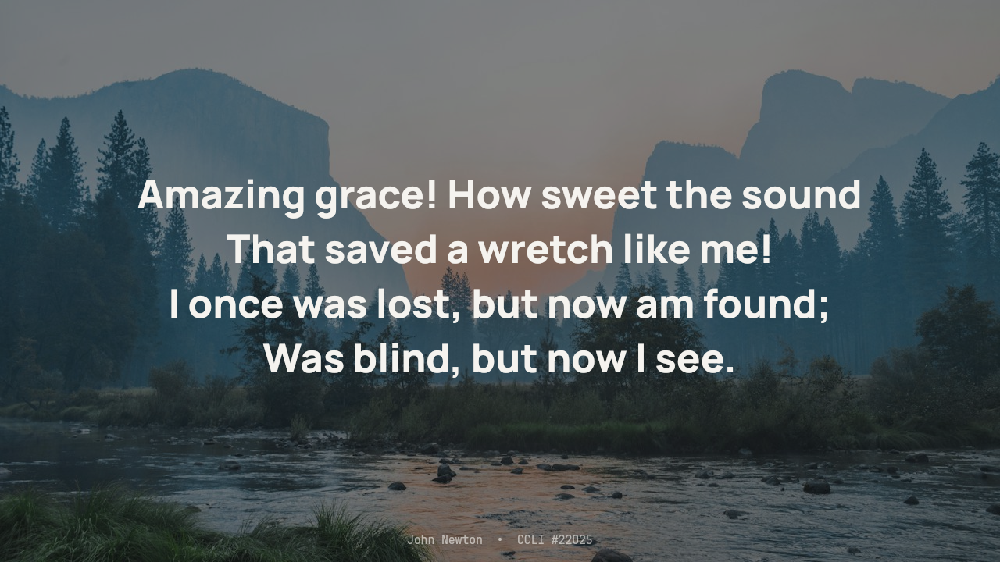
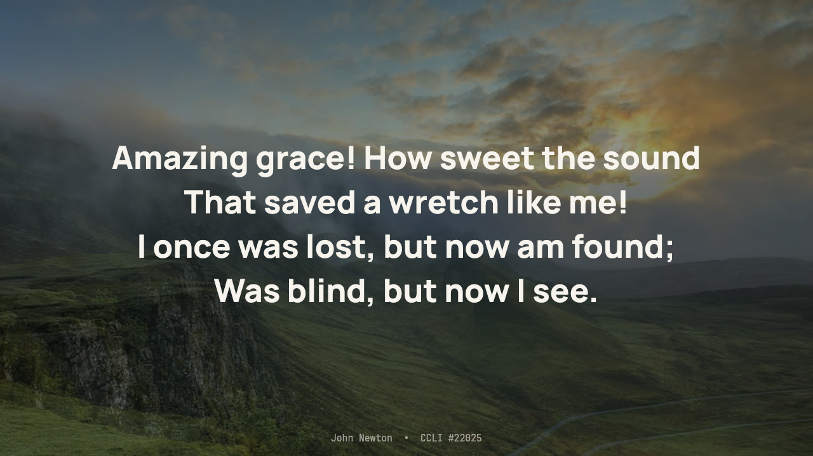
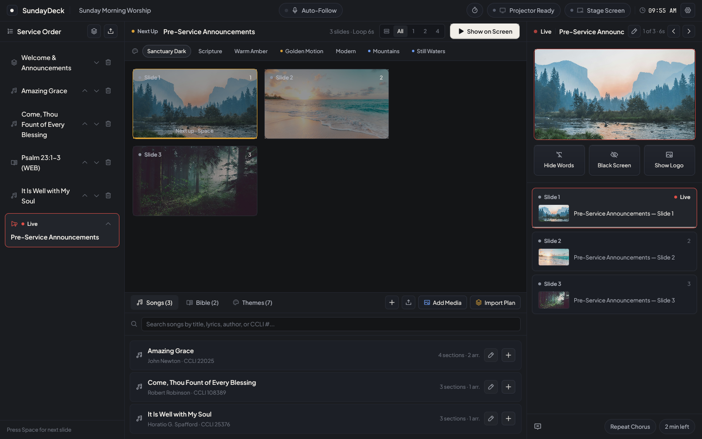
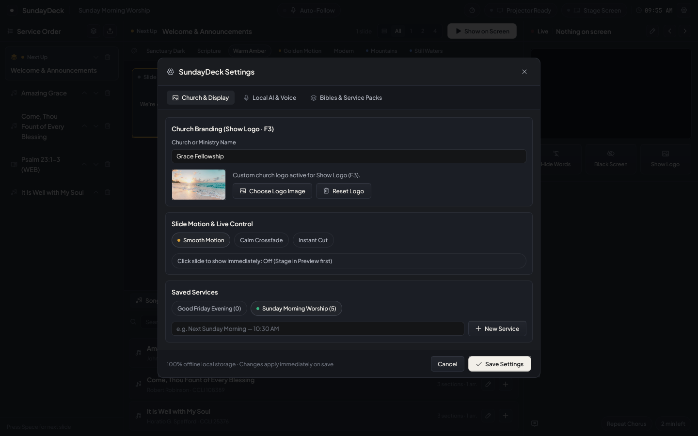
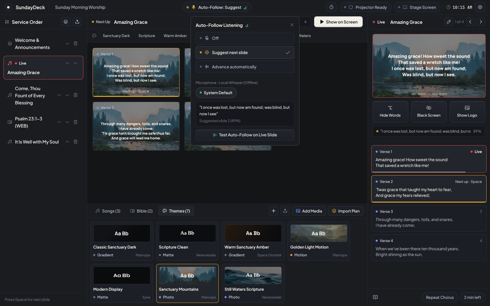

<div align="center">

# SundayDeck

**A calm, GPU-accelerated, offline-first church presentation studio built in Rust.**

*Designed for Sunday volunteers — zero subscriptions, zero cloud lock-in, instant offline Bible lookup, local AI service planning, and mic-driven voice slide navigation.*

[](.github/workflows/ci.yml)
[](.github/workflows/release.yml)
[](LICENSE-MIT)
[](#why-sundaydeck)

<br />


</div>

---

## Visual Walkthrough

Watch SundayDeck move from **Service Order → Live Sanctuary Projection → Unsplash Photo & Looping Motion Video → Pastor `.pptx`/`.docx` Plan Import → Mic Voice Auto-Follow → Stage Confidence Monitor → Custom Church Logo**:

<div align="center">
  
  <br />
  <sub>Full HD walkthrough video: <a href="docs/media/sundaydeck-walkthrough.mp4"><code>docs/media/sundaydeck-walkthrough.mp4</code></a> · Live site source: <a href="docs/index.html"><code>docs/index.html</code></a></sub>
</div>

---

## Why SundayDeck?

Most church presentation suites are either expensive subscriptions, sluggish web wrappers, or packed with broadcast jargon that intimidates a 10-minute-before-service volunteer.

SundayDeck is built from scratch in **Rust + GPUI**:

- **Calm, volunteer-first native UI** — Warm dark-linen surfaces, plain-English controls (`Show on Screen`, `Hide Words`, `Black Screen`, `Show Logo`), zero clutter, zero emojis.
- **100% offline SQLite library** — Songs (with instant FTS5 lyric/CCLI search), non-destructive arrangements, offline multi-translation Bibles, custom themes, and Sunday service schedules all live locally.
- **Dual-display ready** — Independent **Audience Output** (projector/LED wall) and **Stage Confidence Monitor** (current + next slide, clock, speaker countdown, and private booth cues that never leak to the sanctuary).
- **Voice-Synced Auto-Follow** — Hands-free slide navigation listening from your microphone or soundboard feed locally, with safe Suggest/Auto modes and automatic pause during Black/Logo overrides.
- **Pastor Plan Importer** — Drop a pastor's `.pptx` PowerPoint, `.docx` Word doc, or plain outline to generate a complete, reviewable Sunday service plan (deterministic instant mode, optional local LLM via Ollama/`llama-server`, or optional embedded GGUF).
- **Rich Sanctuary Media** — Bundled Unsplash photography, GPU-crossfaded looping motion video backgrounds, PDF/image slide decks, timed pre-service announcement loops, custom church logo branding, and portable `.sdeck` service bundles.

---

## Quick Install

### macOS (Homebrew — Apple Silicon & Intel)

> Replace `OWNER` with your GitHub username or organization once you publish the repo (or create a `homebrew-sundaydeck` tap repository containing [`packaging/homebrew/Casks/sundaydeck.rb`](packaging/homebrew/Casks/sundaydeck.rb)).

```bash
brew tap OWNER/sundaydeck
brew install --cask sundaydeck
```

Or download `SundayDeck-<version>-macOS-arm64.dmg` (Apple Silicon M1–M4) or `SundayDeck-<version>-macOS-x86_64.dmg` (Intel) from **GitHub Releases**, open the DMG, and drag **SundayDeck** into **Applications**.

> **Build a macOS `.dmg` locally on your Mac right now:**
> ```bash
> ./scripts/build-macos-dmg.sh
> # Outputs: dist/SundayDeck-0.1.0-macOS-arm64.dmg
> ```

### Windows (64-bit)

Download from **GitHub Releases**:
- **Installer (recommended):** `SundayDeck-<version>-windows-x86_64-setup.exe` (adds Start Menu shortcut and `.sdeck` bundle file association)
- **Portable ZIP:** `SundayDeck-<version>-windows-x86_64.zip` (unzip and run `SundayDeck.exe` with zero install)

### Linux (Wayland & X11)

Download from **GitHub Releases**:
- **Debian / Ubuntu:**
  ```bash
  sudo apt install ./sundaydeck_<version>_amd64.deb
  ```
- **Portable Tarball (Fedora, Arch, openSUSE, etc.):**
  ```bash
  tar -xzf SundayDeck-<version>-linux-x86_64.tar.gz
  cd SundayDeck-<version>-linux-x86_64
  ./sundaydeck
  ```

### Build from Source (Rust 1.85+)

```bash
git clone https://github.com/OWNER/sundaydeck.git
cd sundaydeck
cargo run --release -p sundaydeck-ui --bin sundaydeck

# Optional: compile with in-process embedded llama.cpp GGUF support
cargo run --release -p sundaydeck-ui --features embedded-llm --bin sundaydeck
```

---

## How to Use SundayDeck (5-Minute Volunteer Guide)

### 1. Plan Your Service — or Drop the Pastor's PowerPoint / Word File

Click the **Upload** icon in the **Service Order** rail (or click the Service Title in the top bar) to drop a `.pptx`, `.docx`, or plain text outline. SundayDeck automatically matches songs in your library, pulls Scripture passages offline, builds sermon point slides, and lets you review every item before applying.

| Pastor Plan Importer | Dual-Display & Stage Confidence Monitor |
| :---: | :---: |
|  |  |

### 2. Choose Sanctuary Backgrounds (Unsplash Photos & Looping Video)

Open the **Themes** tab in the bottom center drawer to switch themes live in one click, or click **Add Background** to apply curated Unsplash photography, download any Unsplash image URL offline, or load local `.mp4` / `.mov` / `.webm` worship motion loops with custom contrast scrims.

| Unsplash Sanctuary Photography | Looping Motion Video Background |
| :---: | :---: |
|  |  |

### 3. Run Live With Zero Stress

1. Click any item in **Service Order** (left rail) to load its 16:9 slide cards into **Next Up** (center).
2. Click **Show on Screen** (or press `Cmd/Ctrl + Enter`) to fade it live onto the projector.
3. Press **`Space`** or **`Right Arrow`** to advance slides.
4. Spot a lyric typo during worship? Press **`Cmd/Ctrl + E`** for live **Quick Edit** — fix the typo in place without interrupting the room.
5. Need an emergency screen recovery? Press **`F1`** (Hide Words), **`F2`** (Black Screen), or **`F3`** (Show Church Logo). Hold **`Shift`** with any F-key for an instant hard cut.

### 4. Pre-Service Announcement Loops, Offline Bibles & Portable `.sdeck` Packs

Click the **Gear** icon in the top right (or the **Packs** button in Service Order) to open **SundayDeck Settings**:

- **Church Branding:** Set your church name and upload a custom Church Logo image for `Show Logo (F3)`.
- **Full 66-Book Offline Bibles:** Import OSIS, USFX, Zefania `.xml`, or `.sqlite` Bible packs for instant offline Scripture projection.
- **PDF / Image Decks & Pre-Service Loops:** Import PDFs or PNG/JPEG slide decks as regular presentations or timed auto-advancing announcement loops (wraps cleanly and pauses automatically whenever Black or Logo is engaged).
- **Portable `.sdeck` Service Bundles:** Export this Sunday's schedule + songs + themes + local media into a single `.sdeck` zip file and open it on the booth computer with zero missing files.

| Pre-Service Announcement Loop | Settings, Branding & Offline Packs |
| :---: | :---: |
|  |  |

---

## Voice-Synced Slide Navigation (Automatic Mic Auto-Follow)

**Yes — live microphone slide navigation is already built into SundayDeck (`crates/sundaydeck-voice`) and runs 100% locally.**

<div align="center">
  
</div>

### How It Works Under the Hood

1. **Native Audio Capture (`cpal`)** — Captures live audio from any laptop mic, USB interface, or soundboard feed on macOS, Windows, and Linux, resampling to 16 kHz mono PCM with an RMS voice-activity gate and live 3-bar level meter.
2. **100% Local Speech-to-Text (`whisper.cpp`)** — Streams rolling 2-second speech windows to a local `whisper-server` on `http://127.0.0.1:8081/inference` (configurable in **Settings → Local AI & Voice**). Audio never touches the internet.
3. **Worship-Aware Slide Aligner (`DeckVoiceAligner`)** — Phonetic normalization, end-of-slide anchor weighting (so slides advance right as the congregation finishes the final line), cooldown debouncing (prevents double-advances on sustained notes), spontaneous Chorus repeat detection, and an automatic safety lock whenever **Black Screen** or **Show Logo** is active.

### Enabling Live Mic Auto-Follow

1. **Start a local Whisper server** (one-time install, runs 100% offline):
   ```bash
   # macOS (Homebrew)
   brew install whisper-cpp
   curl -L -o ggml-base.en.bin https://huggingface.co/ggerganov/whisper.cpp/resolve/main/ggml-base.en.bin
   whisper-server -m ggml-base.en.bin --host 127.0.0.1 --port 8081
   ```
   *(On Windows/Linux, download the prebuilt `whisper-server` binary from [`ggml-org/whisper.cpp`](https://github.com/ggml-org/whisper.cpp/releases) and run the same command.)*
2. Click **Auto-Follow** in SundayDeck's top bar.
3. Pick your microphone / audio interface from **Microphone Input**.
4. Choose **Suggest next slide** (recommended for your first Sunday — highlights the next slide with an amber ring) or **Advance automatically** (advances slides hands-free once alignment confidence crosses your threshold).
5. Want to try it before hooking up a mic? Click **Test Auto-Follow** inside the popover to run the built-in offline rehearsal simulator over your active song or Scripture!

---

## Keyboard Shortcuts

| Action | Shortcut |
| :--- | :--- |
| Next live slide | `Space` / `Right` / `Down` |
| Previous live slide | `Left` / `Up` |
| Show staged preview on screen | `Cmd/Ctrl + Enter` |
| Hide Words (keep background) | `F1` (`Shift + F1` hard cut) |
| Black Screen | `F2` (`Shift + F2` hard cut) |
| Show Church Logo | `F3` (`Shift + F3` hard cut) |
| Quick Edit live slide text | `Cmd/Ctrl + E` |
| Toggle Audience Projector window | `Cmd/Ctrl + Shift + A` |
| Toggle Stage Confidence Monitor | `Cmd/Ctrl + Shift + S` |
| Toggle click-slide-directly-live | `Cmd/Ctrl + Shift + D` |

---

## Publishing Releases, Homebrew Tap & Custom Domain (GitHub Pages)

SundayDeck ships with 3 ready-to-run GitHub Actions workflows:

| Workflow | Trigger | What It Does |
| :--- | :--- | :--- |
| [`.github/workflows/ci.yml`](.github/workflows/ci.yml) | Push / PR to `main` | Runs `cargo fmt --check`, `cargo clippy -- -D warnings`, and full `cargo test --workspace` with headless software Vulkan. |
| [`.github/workflows/release.yml`](.github/workflows/release.yml) | Tag push (`v*`) or manual run | Builds **macOS arm64 + Intel `.dmg`**, **Windows `.exe` + `.zip`**, and **Linux `.deb` + `.tar.gz`**, computes `SHA256SUMS.txt`, generates an updated `sundaydeck.rb` Homebrew Cask, and publishes a GitHub Release. |
| [`.github/workflows/pages.yml`](.github/workflows/pages.yml) | Push to `docs/**` | Deploys [`docs/`](docs/index.html) directly to **GitHub Pages**. |

### Cutting Your First Release

```bash
git tag v0.1.0
git push origin main --tags
```

GitHub Actions automatically builds all 4 platform binaries, attaches every installer + `SHA256SUMS.txt` + updated `sundaydeck.rb` to the GitHub Release.

### Setting Up Your Homebrew Tap

1. Create a public GitHub repo named `homebrew-sundaydeck` under your GitHub account.
2. Copy the release-generated `sundaydeck.rb` into `Casks/sundaydeck.rb` inside `homebrew-sundaydeck` and push.
3. Anyone on macOS can now install with:
   ```bash
   brew tap YOUR_GITHUB_USER/sundaydeck
   brew install --cask sundaydeck
   ```

### Routing Your Custom Domain to GitHub Pages

1. In your repo's **Settings → Pages**, set **Source** to **GitHub Actions**.
2. Create `docs/CNAME` containing only your domain (for example `sundaydeck.org` — see [`docs/CNAME.example`](docs/CNAME.example)) and commit it.
3. At your DNS registrar, configure either:
   - **Apex domain (`yourdomain.com`):** Add four `A` records pointing to GitHub Pages:
     `185.199.108.153`, `185.199.109.153`, `185.199.110.153`, `185.199.111.153`
   - **Subdomain (`app.yourdomain.com` or `www.yourdomain.com`):** Add a `CNAME` record pointing to `<YOUR_GITHUB_USER>.github.io`.
4. Enable **Enforce HTTPS** in GitHub Pages settings once DNS propagates.

---

## Workspace Architecture

```text
crates/
├── sundaydeck-core/     # Pure domain models, PresentationEngine, song reflow, Bible XML parsers, .pptx/.docx extractor, .sdeck zip bundles
├── sundaydeck-db/       # SQLite WAL + FTS5 schema, migrations, seeded songs/themes/Bibles, non-blocking DbWorker
├── sundaydeck-planner/  # Hybrid deterministic + local OpenAI-compatible LLM + optional embedded llama.cpp planner
├── sundaydeck-voice/    # Live cpal mic capture, offline Whisper HTTP client, DeckVoiceAligner, background VoiceEngineHandle
└── sundaydeck-ui/       # Native GPUI operator console, Audience & Stage windows, bundled OFL fonts, vendored Phosphor icons
```

---

## License

Dual-licensed under either [MIT](LICENSE-MIT) or [Apache-2.0](LICENSE-APACHE), at your option.
